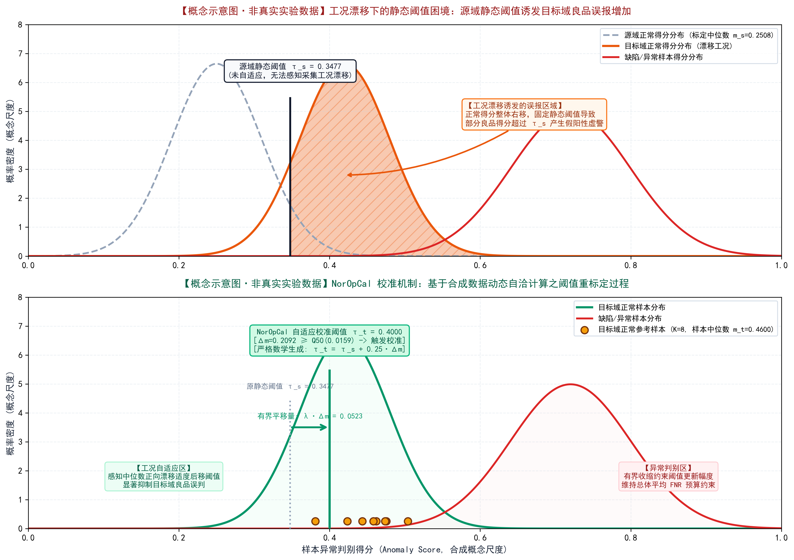

# NorOpCal

**工业视觉异常检测在采集域偏移下的选择性操作点（阈值）自适应校准框架**  
*Normal-Only Selective Operating-Point Calibration for Industrial Visual Anomaly Detection under Acquisition Shift*

<p align="left">
    <a href="README_EN.md">English</a> •
    <a href="README.md"><b>简体中文</b></a>
</p>

[](https://github.com/Fatespur/NorOpCal/actions/workflows/ci.yml)
[](https://www.python.org/downloads/)
[](LICENSE)

NorOpCal 是一种轻量、即插即用的工业异常检测决策阈值校准机制。针对部署后的工业无监督异常检测模型在产线**采集域分布偏移**（如成像工况改变、传感器老化、环境光照漂移）下导致的误报与漏检激增问题，NorOpCal **仅需目标域极少量的正常样本**（$K \approx 8$ 张无缺陷图像），即可保守、选择性地自适应重校准模型的**操作点（决策阈值）**。

整个过程**无需目标域缺陷样本、无需人工标签、无需像素级掩码，且完全无需微调或重新训练检测器主干网络**。


---

## 核心痛点与方法原理

在工业视觉检测中，部署后的异常检测器阈值 $\tau_s$ 通常在源域（标准工况）下标定。当产线环境出现**采集域偏移**时，目标域正常样本的得分分布整体漂移，导致误报率或漏检率上升。而重新采集大量缺陷样本进行微调成本极高且严重影响产线节拍。

NorOpCal 将该问题形式化为**仅基于正常样本的操作点安全校准机制**，核心包含三个连续阶段：

1. **中位数漂移感知（Median-Shift Sensing）**：  
   计算源域与目标域正常样本得分分布的中位数位移信号：
   $$\Delta m = \text{median}(S_{\text{target, normal}}) - \text{median}(S_{\text{source, normal}})$$
2. **可纠正性门控（Correctability Gate, $Q_{50}$）**：  
   仅当检测到的分布漂移显著大于预注册的稳健阈值时才触发校准（$\Delta m \ge Q_{50}$，其中冻结分位数 $Q_{50} = 0.01589$）；若未达标，则**主动放弃校准（Abstain）**，保持源域静态阈值 $\tau_s$，在测试集上有效抑制微弱漂移下的盲目校准。
3. **保守有界执行器（Conservative Bounded Actuator）**：  
   在门控通过后，实施受约束的有界收缩平移更新：
   $$\tau_t = \tau_s + \lambda \cdot \Delta m \quad (\text{预注册冻结系数 } \lambda = 0.25)$$

> **核心设计理念**：检测器的特征提取器、记忆库与样本异常度排序在数学上完全保持冻结。**“主动放弃校准”是本系统精心设计的安全保护行为，而非算法失效。**

---

## 科研复现范围与资产边界声明

为确保学术严谨性与读者预期一致，本项目明确区分三个不同层次的复现范围：

| 复现层级 | 包含内容 | 运行命令 | 是否依赖外部资产 |
| :--- | :--- | :--- | :--- |
| **Level 1：核心算法与 API** | 核心自包含算法库 `src/noropcal`、权威冻结规范 `load_frozen_spec()` 及全套自动化单元测试。 | `pytest tests/` | **否**（完全自包含，已纳入 CI） |
| **Level 2：原理演示与合成验证** | 合成工况漂移下的端到端快速上手演示与 5 张学术概念诊断图表生成。 | `python scripts/demo.py`<br>`python assets/figures/generate_all_figures.py` | **否**（开箱即用，已纳入 CI） |
| **Level 3：论文全量实验复现** | 论文涉及的全部 39 个工况单元、完整高分辨率工业图像特征抽取与跨模型重跑。 | 依赖历史全量重跑流水线 | **是**（需自备数百 GB 的 MVTec AD 2 原始图像与各模型 Checkpoint 权重） |

> [!IMPORTANT]
> **开源范围提示**：本 GitHub 仓库通过 Level 1 和 Level 2 测试，保证了算法实现与冻结规范的代码级一致性。但**通过 Level 1 / Level 2 测试绝不等于 Level 3 全量论文实验已由本仓库直接复现**。外部用户复现 Level 3 需按协议自行获取受控数据集并配置环境变量。

---

## 极速上手

### 1. 环境安装

```bash
git clone https://github.com/Fatespur/NorOpCal.git
cd NorOpCal

# 创建虚拟环境（可选）
python -m venv .venv && source .venv/bin/activate  # Windows: .venv\Scripts\Activate.ps1
pip install -r requirements.txt
pip install -e ".[dev]"
```

### 2. Python API 快速调用

```python
import numpy as np
from noropcal import NorOpCal

# 初始化校准器（自动加载冻结推荐参数: lambda=0.25, Q50 门控）
calibrator = NorOpCal()

# 准备源域正常得分与目标域少量正常得分 (例如 K=8)
source_normal_scores = np.array([0.12, 0.15, 0.14, 0.18, 0.11])
target_normal_scores = np.array([0.31, 0.33, 0.29, 0.35])
tau_source = 0.25  # 源域初始操作阈值

# 自适应计算目标域最佳决策阈值
tau_target = calibrator.threshold(source_normal_scores, target_normal_scores, tau_source)
print(f"自适应决策阈值校准结果: {tau_source:.4f} -> {tau_target:.4f}")
```

### 3. 运行交互式演示

```bash
python scripts/demo.py
```

### 4. 自动化单元测试

```bash
python -m pytest -v tests/
```

---

## 核心实验结论与适用边界

### 1. 核心实证结论 (Principal Result)

依据论文正式冻结的研究结果，NorOpCal 的核心性能增益是在 **DINOv2 主干网络**、**$K=8$ 正常样本支持集**、以及 **10 个符合评估资格的 TEST 单元**（`fabric` 5 个工况 + `walnuts` 5 个工况）上测得，**并非跨所有检测器的普遍收益**：

| 策略方案 (Policy) | $\Delta$ 平衡准确率 (BA, pp) | $\Delta$ 漏检率 (FNR, pp) | 危害率 (Harm Rate, %) | 覆盖率 (Coverage, %) |
|---|---|---|---|---|
| **不校准 (NoAdapt, $\tau_s$)** | 0.00 (基准; BA 0.5411) | 0.00 | 0.00 | 0.00 |
| **仅门控机制 ($\lambda=1.0$, Q50)** | +4.25 [+3.96, +4.55] | +7.49 | 37.67 | 40.33 |
| **仅有界收缩 ($\lambda=0.25$, 无门控)** | +3.64 [+3.52, +3.76] | −0.16 | 3.67 | 100.00 |
| **NorOpCal 全策略 ($\lambda=0.25$, Q50)** | **+3.23 [+2.70, +3.76]** | **+0.24** | **3.67** | **40.33** |

*注：区间为类别感知 Block-Bootstrap (B=10,000) 95% 置信区间。预注册安全约束 $\mathbb{E}[\Delta FNR] \le +0.02$ 是**指定测试总体上的平均退化预算**，而非针对单个工况单元或单个输入样本的确定性绝对安全保证。*

### 2. 实测现象与机制假设 (Empirical Observation vs. Hypothesized Mechanism)

阈值自适应校准的有效性高度取决于特征空间的几何结构与漂移规律。我们对评测的主干做出明确界定：

- **DINOv2 (`dinov2_vits14`)**：
  - *实测现象*：判定为 **USEFUL_SAFE_SELECTABLE**，在 10 个测试单元取得确定性正向收益（+3.23 pp）。
  - *机制假设*：推测其深层自监督特征空间在成像工况漂移下表现出相对刚性的平移特性，使标量中位数位移能有效表征决策界调整量。
- **PatchCore (`wide_resnet50_2`)**：
  - *实测现象*：判定为 **ACTUATOR_MISMATCH**（动作器失配），阈值调整带来决策指标大幅波动。
  - *机制假设*：推测由于记忆库最邻近距离判别受局部邻域非各向同性形变影响，简单的标量平移执行器存在机制失配。
- **EfficientAD (70,000 steps)**：
  - *实测现象*：判定为 **NO_HEADROOM**（无调优余量），基线在目标工况下无显著改善空间。
  - *机制假设*：推测学生-教师网络在该工况漂移下基线输出已有特定收敛，标量阈值调整无增益余量。

### 3. 数据集与样本量资格说明

- **基准数据集**：MVTec AD 2 共包含 8 个品类（`can`, `fabric`, `fruit_jelly`, `rice`, `sheet_metal`, `vial`, `wallplugs`, `walnuts`）合计 39 个工况单元。其中 DEV 集包含 13 个单元，TEST 集包含 26 个单元。
- **$K=8$ 资格限制**：开展 $K=8$ 校准要求目标域至少包含 8 张独立无缺陷正常图像。在 26 个 TEST 单元中，仅 `fabric`（5 个单元）与 `walnuts`（5 个单元）共 **10 个单元**满足资格；其余 16 个单元存在真实的数据短缺，不满足评估条件。

---

## 机制分析与诊断可视化

| 策略消融权衡 (DINOv2 实测连续坐标) | 机制归因：有界收缩控危害，门控机制施选择 |
|:---:|:---:|
|  |  |

| 小样本中位数渐近标准误与机制判定卡片 | 工况漂移与决策阈值校准机制【合成数据概念示意】 |
|:---:|:---:|
|  |  |

> *图表说明*：
> - **Fig 2** 采用真实连续坐标展示 4 组消融策略（未进行人为截断），真实呈现激进更新 37.67% 的高危害率与有界收缩的低危害表现。
> - **Fig 4** 明确将机制归因分开：有界收缩是将危害率从 37.67% 降至 3.67% 的核心控制机制；门控机制并未进一步压低危害率（两者同为 3.67%），其核心作用在于提供 40.33% 的选择性触发与弃权保护。
> - **Fig 3** 左图阐释中位数估计量渐近标准误（$O(1/\sqrt{K})$）的衰减规律，右图为分类状态判定卡片（无任意数值化柱长）。
> - **Fig 5** 基于同一组合成数据动态计算中位数、门控判定与有界更新阈值，确保数学逻辑完全自洽（已去除任何绝对安全断言）。

---

## 项目目录架构

```text
NorOpCal/
├── .github/
│   └── workflows/ci.yml  # 自动化持续集成流水线 (CI)
├── assets/
│   └── figures/          # 架构图、消融实测图与数学自洽概念示意图
├── configs/              # 检测器与协议配置文件
├── docs/                 # 详细学术与数据协议规范
│   ├── METHOD.md         # 算法数学推导、门控设计与适用边界
│   ├── DATASETS.md       # 数据集协议、工况划分与资格审查
│   └── KNOWN_ISSUES.md   # 科研边界与工程考量
├── scripts/
│   └── demo.py           # 30 秒开箱即用演示脚本
├── src/
│   ├── noropcal/         # NorOpCal 核心自包含校准算法与 API 接口
│   └── shiftad/          # 异常检测器适配与主干支撑模块
├── tests/                # 自动化单元测试套件 (pytest)
├── pyproject.toml        # 标准 Python 打包与构建配置
└── requirements.txt      # 依赖清单
```

---

## 引用声明

如果您在科研或项目中参考了本项目，请按如下格式引用：

```bibtex
@software{noropcal2026,
  author = {Fatespur},
  title = {NorOpCal: Normal-Only Selective Operating-Point Calibration for Industrial Visual Anomaly Detection under Acquisition Shift},
  url = {https://github.com/Fatespur/NorOpCal},
  year = {2026}
}
```
