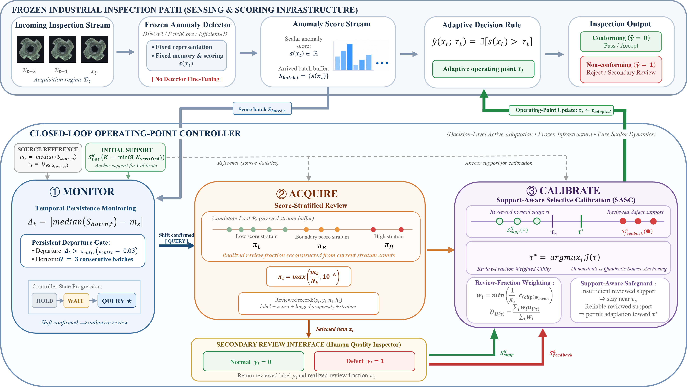
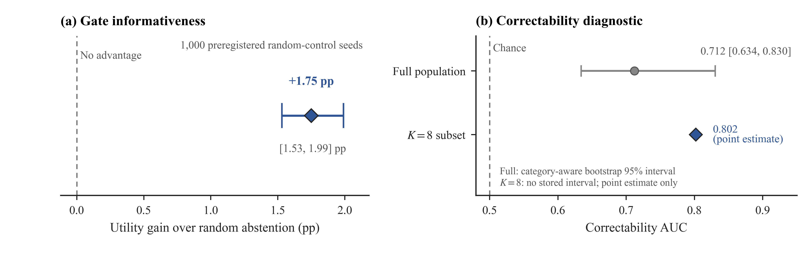
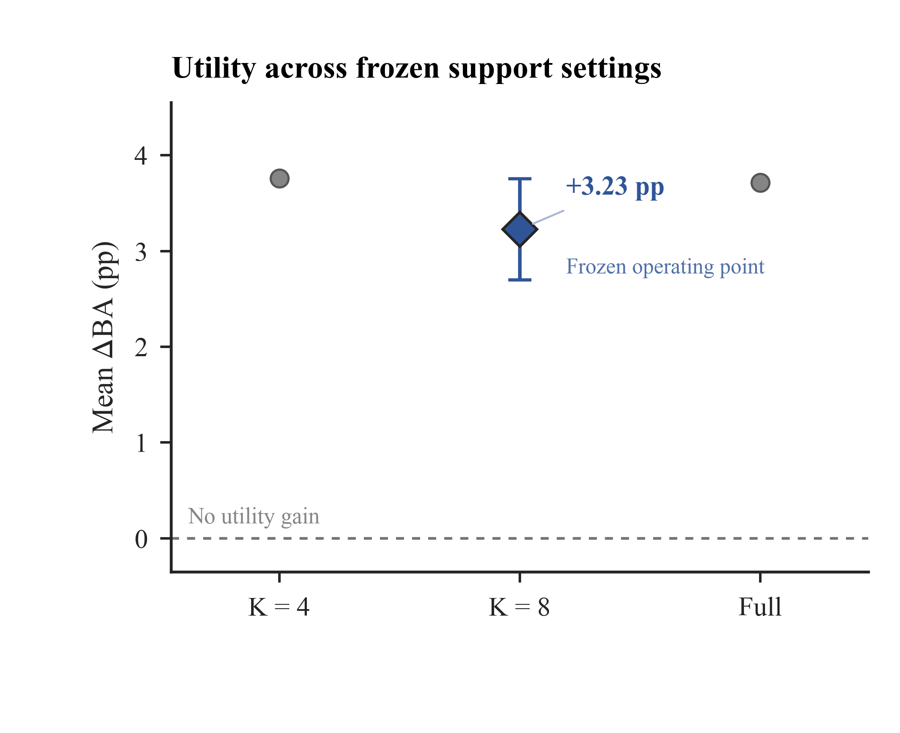

# NorOpCal

**工业视觉异常检测在采集域偏移下的选择性操作点（阈值）自适应校准框架**  
*Normal-Only Selective Operating-Point Calibration for Industrial Visual Anomaly Detection under Acquisition Shift*

<p align="left">
    <a href="README_EN.md">English</a> •
    <a href="README.md"><b>简体中文</b></a>
</p>

[](https://www.python.org/downloads/)
[](https://opensource.org/licenses/MIT)

NorOpCal 是一种轻量且即插即用的决策校准框架。针对工业无监督异常检测模型在产线**采集域分布偏移**（如成像工况改变、传感器老化、环境光照漂移）下导致的漏检与误报激增问题，NorOpCal **仅需目标域极少量的正常样本**（$K \approx 8$ 张无缺陷图像），即可保守、选择性地自适应重校准模型的**操作点（决策阈值）**。

整个过程**无需目标域异常样本、无需人工标签、无需像素级掩码，且完全无需微调或重新训练检测器主干网络**。



---

## 核心痛点与方法原理

在工业视觉检测中，部署后的异常检测器阈值 $\tau_s$ 通常在源域（标准工况）下标定。当产线环境出现**采集域偏移**时，目标域样本的得分分布整体漂移，导致漏检率（FNR）或误报率陡增。而重新采集大量缺陷样本进行微调成本极高且严重影响产线节拍。

NorOpCal 将该问题形式化为**仅基于正常样本的操作点安全校准机制**，核心包含三个连续阶段：

1. **中位数漂移感知（Median-Shift Sensing）**：  
   计算源域与目标域正常样本得分分布的中位数位移信号：
   $$\Delta m = \text{median}(S_{\text{target, normal}}) - \text{median}(S_{\text{source, normal}})$$
2. **可纠正性门控（Correctability Gate, $Q_{50}$）**：  
   仅当检测到的分布漂移显著大于预注册的稳健阈值时才触发校准（$\Delta m \ge Q_{50}$，其中冻结分位数 $Q_{50} = 0.01589$）；若未达标，则**主动放弃校准（Abstain）**，保持源域阈值 $\tau_s$，彻底防止弱漂移下的盲目校准带来负迁移危害。
3. **保守有界执行器（Conservative Bounded Actuator）**：  
   在门控通过后，实施受约束的收缩自适应更新：
   $$\tau_t = \tau_s + \lambda \cdot \Delta m \quad (\text{预注册冻结系数 } \lambda = 0.25)$$

> **核心设计理念**：检测器的特征提取器、记忆库与样本异常度排序完全保持冻结。**“主动放弃校准”是本系统精心设计的安全保护行为，而非算法失效。**

---

## 极速上手

### 1. 环境安装

```bash
git clone https://github.com/Fatespur/NorOpCal.git
cd NorOpCal

# 创建虚拟环境（可选）
python -m venv .venv && source .venv/bin/activate  # Windows: .venv\Scripts\Activate.ps1
pip install -r requirements.txt
pip install -e .
```

### 2. Python API 快速调用

```python
import numpy as np
from noropcal import NorOpCal

# 初始化校准器（自动加载冻结推荐参数: lambda=0.25, Q50 门控）
calibrator = NorOpCal()

# 准备源域正常得分与目标域少量正常得分 (例如 K=8)
source_normal_scores = np.array([0.12, 0.15, 0.14, 0.18, 0.11])
target_normal_scores = np.array([0.31, 0.33, 0.29, 0.35])
tau_source = 0.25  # 源域初始操作阈值

# 自适应计算目标域最佳决策阈值
tau_target = calibrator.threshold(source_normal_scores, target_normal_scores, tau_source)
print(f"自适应决策阈值校准结果: {tau_source:.4f} -> {tau_target:.4f}")
```

### 3. 运行交互式演示

```bash
python scripts/demo.py
```

### 4. 自动化单元测试

```bash
pytest tests/
```

---

## 核心实验结论与基准数据

在标准工业异常检测基准数据集 **MVTec AD 2**（涵盖 8 类工业品、39 种工况偏移）上，基于 DINOv2、PatchCore 和 EfficientAD 主干的综合评测表现如下（$K=8$ 正常样本）：

| 策略方案 (Policy) | $\Delta$ 平衡准确率 (BA, pp) | $\Delta$ 漏检率 (FNR, pp) | 伤害率 (Harm Rate, %) | 覆盖率 (Coverage, %) |
|---|---|---|---|---|
| **不校准 (NoAdapt, $\tau_s$)** | 0.00 (基准; BA 0.5411) | 0.00 | 0.00 | 0.00 |
| **仅有界收缩 ($\lambda=0.25$, 无门控)** | +3.64 [+3.52, +3.76] | −0.16 | 3.67 | 100.00 |
| **仅门控机制 ($\lambda=1.0$, Q50)** | +4.25 [+3.96, +4.55] | +7.49 | 37.67 | 40.33 |
| **NorOpCal 全策略 ($\lambda=0.25$, Q50)** | **+3.23 [+2.70, +3.76]** | **+0.24** | **3.67** | **40.33** |

### 核心诊断可视化

| 门控有效性与安全性诊断 | 不同样本量 ($K$) 支撑集效用分析 |
|---|---|
|  |  |

---

## 项目目录架构

```text
NorOpCal/
├── assets/
│   └── figures/          # 高分辨率基准与诊断示意图 (PNG)
├── configs/              # 检测器与数据集配置文件
├── docs/                 # 核心理论与数据集协议文档
│   ├── METHOD.md         # 算法数学推导与边界证明
│   ├── DATASETS.md       # 数据集协议与规范
│   └── KNOWN_ISSUES.md   # 科研边界与工程考量
├── scripts/
│   └── demo.py           # 30秒开箱即用演示脚本
├── src/
│   ├── noropcal/         # NorOpCal 核心自包含校准算法与 API 接口
│   └── shiftad/          # 异常检测器适配与主干支撑模块
├── tests/                # 自动化测试用例套件 (pytest)
├── pyproject.toml        # 标准 Python 打包与构建配置
└── requirements.txt      # 依赖清单
```

---

## 引用声明

如果您在科研或项目中参考了本项目，请按如下格式引用：

```bibtex
@software{noropcal2026,
  author = {Fatespur},
  title = {NorOpCal: Normal-Only Selective Operating-Point Calibration for Industrial Visual Anomaly Detection under Acquisition Shift},
  url = {https://github.com/Fatespur/NorOpCal},
  year = {2026}
}
```

---

## 开源协议

本项目采用 [MIT 许可证](LICENSE) 开源。
