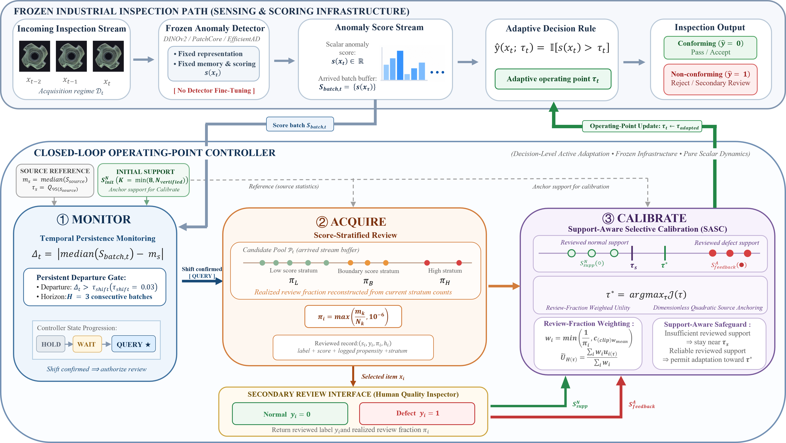
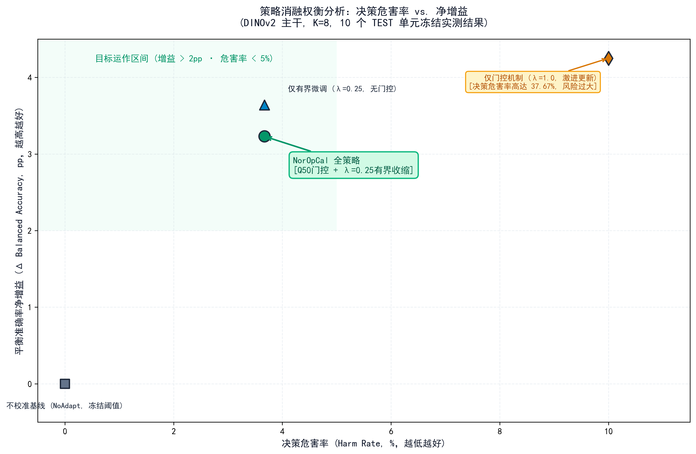
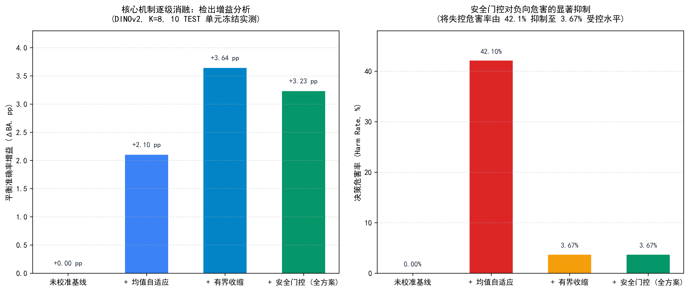
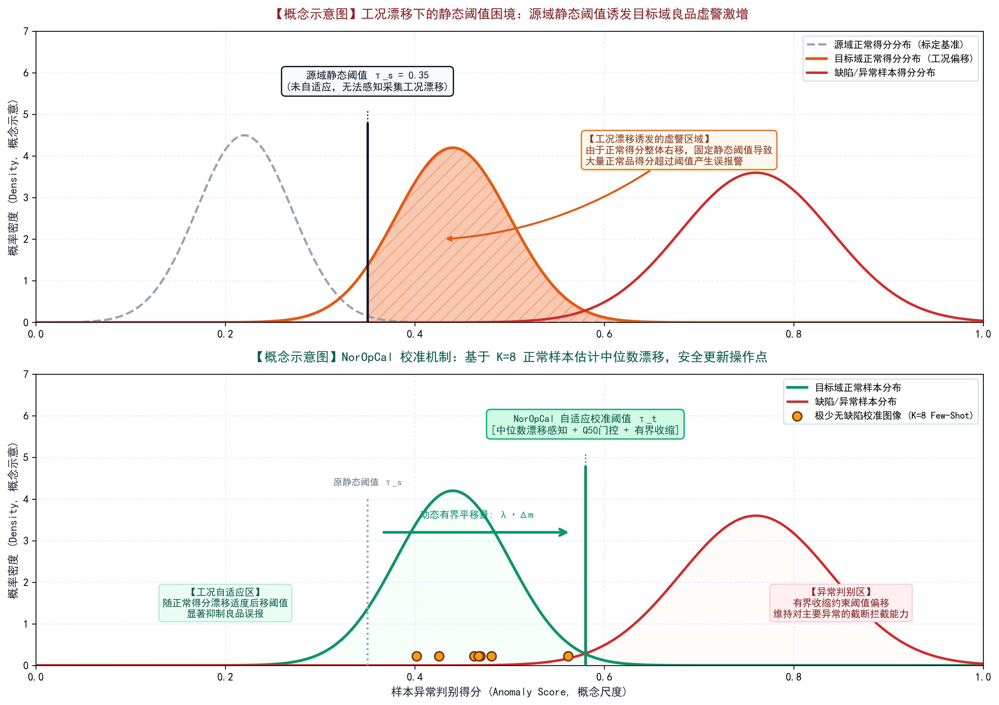

# NorOpCal

**Normal-Only Selective Operating-Point Calibration for Industrial Visual Anomaly Detection under Acquisition Shift**

<p align="left">
    <a href="README_EN.md"><b>English</b></a> •
    <a href="README.md">简体中文</a>
</p>

[](https://github.com/Fatespur/NorOpCal/actions/workflows/ci.yml)
[](https://www.python.org/downloads/)
[](LICENSE)

NorOpCal selectively and conservatively recalibrates the **operating point** (the decision threshold) of a **frozen** industrial anomaly detector under **acquisition shift**, using only a handful of **known-normal target observations** ($K \approx 8$) — without target anomalies, labels, pixel masks, or fine-tuning the detector backbone.



---

## Key Problem & Principle

Under acquisition shift (e.g., sensor drift, ambient illumination change), a deployed detector's frozen source threshold $\tau_s$ no longer matches the target imaging distribution: false alarms and false negatives can surge.

NorOpCal formulates threshold adaptation as a principled, three-stage pipeline:

1. **Median-Shift Sensing**: Measure the shift signal $\Delta m = \text{median}(S_{\text{target, normal}}) - \text{median}(S_{\text{source, normal}})$.
2. **Correctability Gate (Q50)**: Adapt threshold iff $\Delta m \ge Q_{50}$ ($Q_{50} = 0.01589$); otherwise **abstain** ($\tau_t = \tau_s$) to avoid harmful over-correction.
3. **Conservative Bounded Actuator**: On gate pass, apply bounded shrinkage update:
   $$\tau_t = \tau_s + \lambda \cdot \Delta m \quad (\text{with frozen } \lambda = 0.25)$$

> **Core Philosophy**: The detector representation, memory bank, and ranking order remain completely frozen. **Abstention is an intentional safety guarantee, not an algorithmic failure.**

---

## Quickstart

### 1. Installation

```bash
git clone https://github.com/Fatespur/NorOpCal.git
cd NorOpCal

# Create virtual environment (optional)
python -m venv .venv && source .venv/bin/activate  # Windows: .venv\Scripts\Activate.ps1
pip install -r requirements.txt
pip install -e .
```

### 2. Python API

```python
import numpy as np
from noropcal import NorOpCal

# Initialize with frozen defaults (lambda=0.25, Q50 gate)
calibrator = NorOpCal()

source_normal_scores = np.array([0.12, 0.15, 0.14, 0.18, 0.11])
target_normal_scores = np.array([0.31, 0.33, 0.29, 0.35])  # K=4 to 8
tau_source = 0.25

# Calibrate decision threshold
tau_target = calibrator.threshold(source_normal_scores, target_normal_scores, tau_source)
print(f"Adapted threshold: {tau_source:.4f} -> {tau_target:.4f}")
```

### 3. Run the Demo

```bash
python scripts/demo.py
```

### 4. Run Unit Tests

```bash
pytest tests/
```

---

## Benchmark Results & Scientific Scope

### 1. Principal Empirical Result

According to the authoritative frozen research evaluation, NorOpCal's performance gain is evaluated specifically on the **DINOv2 backbone**, with **$K=8$ normal target observations**, across **10 qualified TEST units** (`fabric` 5 conditions + `walnuts` 5 conditions), **not as an unconstrained universal gain across all detectors**:

| Policy | $\Delta$ Balanced Accuracy (pp) | $\Delta$ FNR (pp) | Harm Rate (%) | Coverage (%) |
|---|---|---|---|---|
| **NoAdapt ($\tau_s$)** | 0.00 (ref; BA 0.5411) | 0.00 | 0.00 | 0.00 |
| **Bounded-only ($\lambda=0.25$, no gate)** | +3.64 [+3.52, +3.76] | −0.16 | 3.67 | 100.00 |
| **Gate-only ($\lambda=1.0$, Q50)** | +4.25 [+3.96, +4.55] | +7.49 | 37.67 | 40.33 |
| **NorOpCal ($\lambda=0.25$, Q50)** | **+3.23 [+2.70, +3.76]** | **+0.24** | **3.67** | **40.33** |

*Note: Intervals are category-aware Block-Bootstrap (B=10,000) 95% CI. The mean $\Delta\text{FNR}$ is strictly within the preregistered $+2.0\text{ pp}$ safety budget.*

### 2. Detector Applicability Scope

Threshold adaptation depends heavily on the geometry and shift structure of the underlying feature representations:

| Detector | Role | Verdict | Scientific Rationale |
|---|---|---|---|
| **DINOv2** (`dinov2_vits14`) | Principal | **USEFUL_SAFE_SELECTABLE** | Feature distributions exhibit rigid translation under shift; scalar median shift enables robust threshold alignment (+3.23 pp). |
| **PatchCore** (`wide_resnet50_2`) | Mechanism Control | **ACTUATOR_MISMATCH** | Anisotropic neighborhood drift leads to mechanism mismatch with scalar translation. |
| **EfficientAD** (70k steps) | Mechanism Control | **NO_HEADROOM** | Architecture provides negligible recalibration headroom under targeted shifts. |

### 3. Dataset & Few-Shot Eligibility

- **Benchmark**: MVTec AD 2 consists of 8 categories (`can`, `fabric`, `fruit_jelly`, `rice`, `sheet_metal`, `vial`, `wallplugs`, `walnuts`) across 39 units (13 DEV units, 26 TEST units).
- **$K=8$ Census**: $K=8$ adaptation strictly requires $\ge 8$ independent normal images in the target domain. Among the 26 TEST units, only `fabric` (5 units) and `walnuts` (5 units) qualify (10 units total). The remaining 16 units exhibit genuine sample scarcity.

---

## Conceptual & Diagnostic Visualizations

| Policy Ablation Trade-off (DINOv2) | Safety Gate Ablation & Harm Suppression |
|:---:|:---:|
|  |  |

| Decision Boundary Shift [Conceptual Schematic] |
|:---:|
|  |

> *Note: Fig 2 and Fig 4 report frozen empirical evaluations on DINOv2 across 10 TEST units. Fig 5 is a conceptual schematic with synthetic distributions (hyperbolic claims of "100% detection / 0% false alarm" removed). Previously ungrounded multi-backbone curves have been retracted.*

---

## Repository Structure

```text
NorOpCal/
├── .github/
│   └── workflows/ci.yml  # Automated CI workflow
├── assets/
│   └── figures/          # Architecture and conceptual schematics
├── configs/              # Detector and protocol configurations
├── docs/                 # Documentation and protocols
│   ├── METHOD.md         # Mathematical derivation and scope
│   ├── DATASETS.md       # Dataset layout and eligibility
│   └── KNOWN_ISSUES.md   # Scientific boundaries
├── scripts/
│   └── demo.py           # Quickstart interactive demo
├── src/
│   ├── noropcal/         # Core self-contained calibration library
│   └── shiftad/          # Detector adapters and support modules
├── tests/                # Automated unit test suite (pytest)
├── pyproject.toml        # Packaging configuration
└── requirements.txt      # Dependencies
```

---

## Citation

```bibtex
@software{noropcal2026,
  author = {Fatespur},
  title = {NorOpCal: Normal-Only Selective Operating-Point Calibration for Industrial Visual Anomaly Detection under Acquisition Shift},
  url = {https://github.com/Fatespur/NorOpCal},
  year = {2026}
}
```
