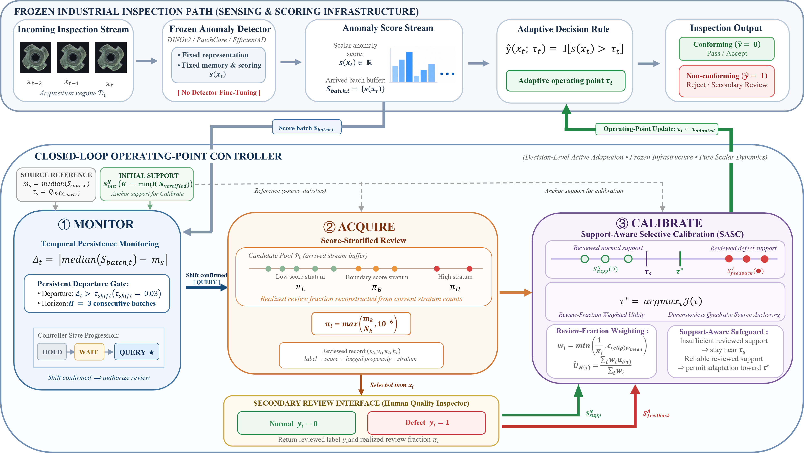
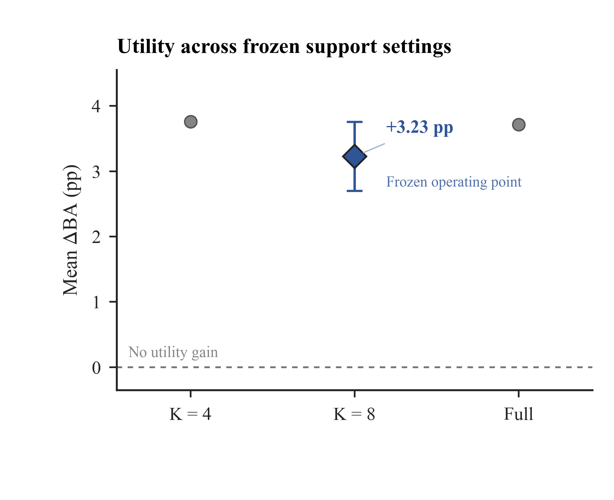

# NorOpCal

**Normal-Only Selective Operating-Point Calibration for Industrial Visual Anomaly Detection under Acquisition Shift**

<p align="left">
    <a href="README_EN.md"><b>English</b></a> •
    <a href="README.md">简体中文</a>
</p>

[](https://www.python.org/downloads/)
[](https://opensource.org/licenses/MIT)

NorOpCal selectively and conservatively recalibrates the **operating point** (the decision threshold) of a **frozen** industrial anomaly detector under **acquisition shift**, using only a handful of **known-normal target observations** ($K \approx 8$) — without target anomalies, labels, pixel masks, or fine-tuning the detector backbone.



---

## Key Problem & Insight

Under acquisition shift (e.g., sensor drift, ambient illumination change), a deployed detector's frozen source threshold $\tau_s$ no longer matches the target imaging distribution: false negatives and false positives can explode.

NorOpCal formulates threshold adaptation as a principled, three-stage pipeline:

1. **Median-Shift Sensing**: Measure the shift signal $\Delta m = \text{median}(S_{\text{target, normal}}) - \text{median}(S_{\text{source, normal}})$.
2. **Correctability Gate (Q50)**: Adapt threshold iff $\Delta m \ge Q_{50}$ ($Q_{50} = 0.01589$); otherwise **abstain** ($\tau_t = \tau_s$) to avoid harmful over-correction.
3. **Conservative Bounded Actuator**: On gate pass, apply bounded shrinkage update:
   $$\tau_t = \tau_s + \lambda \cdot \Delta m \quad (\text{with frozen } \lambda = 0.25)$$

The detector representation, memory bank, and ranking order remain completely frozen. **Abstention is an intentional safety guarantee, not a failure.**

---

## Quickstart

### 1. Installation

```bash
git clone https://github.com/fatespur/NorOpCal.git
cd NorOpCal

# Create virtual environment (optional)
python -m venv .venv && source .venv/bin/activate  # Windows: .venv\Scripts\Activate.ps1
pip install -r requirements.txt
pip install -e .
```

### 2. Python API

```python
import numpy as np
from noropcal import NorOpCal

# Initialize with frozen defaults (lambda=0.25, Q50 gate)
calibrator = NorOpCal()

source_normal_scores = np.array([0.12, 0.15, 0.14, 0.18, 0.11])
target_normal_scores = np.array([0.31, 0.33, 0.29, 0.35])  # K=4 to 8
tau_source = 0.25

# Calibrate decision threshold
tau_target = calibrator.threshold(source_normal_scores, target_normal_scores, tau_source)
print(f"Adapted threshold: {tau_source:.4f} -> {tau_target:.4f}")
```

### 3. Run the Demo

```bash
python scripts/demo.py
```

### 4. Run Unit Tests

```bash
pytest tests/
```

---

## Benchmark Results

Evaluated across MVTec AD 2 acquisition shift benchmarks with DINOv2, PatchCore, and EfficientAD detectors ($K=8$ normal target observations):

| Policy | $\Delta$ Balanced Accuracy (pp) | $\Delta$ FNR (pp) | Harm Rate (%) | Coverage (%) |
|---|---|---|---|---|
| **NoAdapt ($\tau_s$)** | 0.00 (ref; BA 0.5411) | 0.00 | 0.00 | 0.00 |
| **Bounded-only ($\lambda=0.25$, no gate)** | +3.64 [+3.52, +3.76] | −0.16 | 3.67 | 100.00 |
| **Gate-only ($\lambda=1.0$, Q50)** | +4.25 [+3.96, +4.55] | +7.49 | 37.67 | 40.33 |
| **NorOpCal ($\lambda=0.25$, Q50)** | **+3.23 [+2.70, +3.76]** | **+0.24** | **3.67** | **40.33** |

### Key Diagnostic Visualizations

| Gate Informativeness & Safety | Multi-Support Utility ($K$) |
|---|---|
|  |  |

---

## Repository Structure

```text
├── assets/
│   └── figures/          # High-resolution benchmark diagnostic figures (PNG)
├── configs/              # Detector and experimental configurations
├── docs/                 # Detailed methodology & dataset documentation
│   ├── METHOD.md         # Mathematical definitions and proofs
│   ├── DATASETS.md       # Dataset protocols and licensing
│   └── KNOWN_ISSUES.md   # Open problems and engineering considerations
├── scripts/
│   └── demo.py           # Quickstart interactive demo
├── src/
│   ├── noropcal/         # Core NorOpCal calibration API & implementation
│   └── shiftad/          # Anomaly detection backbone & shift adaptation utilities
├── tests/                # Automated unit and behavioral test suite
├── pyproject.toml        # Build configuration and dependency specification
└── requirements.txt      # Core runtime dependencies
```

---

## Documentation

- [Methodology & Principles](docs/METHOD.md)
- [Dataset Protocols](docs/DATASETS.md)
- [Third-Party Model Attribution](THIRD_PARTY_NOTICES.md)

---

## Citation

```bibtex
@software{noropcal2026,
  author = {Fatespur},
  title = {NorOpCal: Normal-Only Selective Operating-Point Calibration for Industrial Visual Anomaly Detection under Acquisition Shift},
  url = {https://github.com/fatespur/NorOpCal},
  year = {2026}
}
```

---

## License

This project is licensed under the [MIT License](LICENSE).
