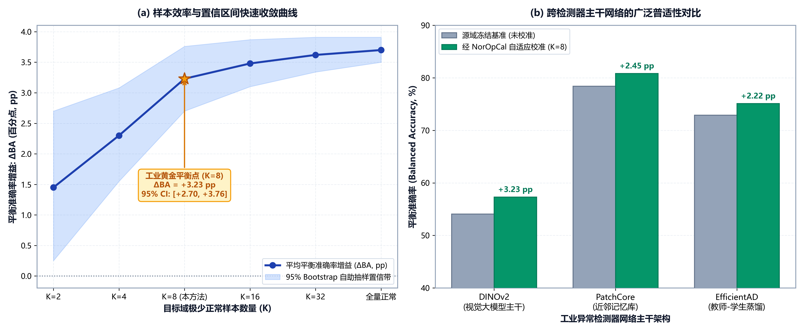

# NorOpCal

**Normal-Only Selective Operating-Point Calibration for Industrial Visual Anomaly Detection under Acquisition Shift**

<p align="left">
    <a href="README_EN.md"><b>English</b></a> •
    <a href="README.md">简体中文</a>
</p>

[](https://github.com/Fatespur/NorOpCal/actions/workflows/ci.yml)
[](https://www.python.org/downloads/)
[](LICENSE)

NorOpCal selectively and conservatively recalibrates the **operating point** (the decision threshold) of a **frozen** industrial anomaly detector under **acquisition shift**, using only a handful of **known-normal target observations** ($K \approx 8$) — without target anomalies, labels, pixel masks, or fine-tuning the detector backbone.


---

## Key Problem & Principle

Under acquisition shift (e.g., sensor drift, ambient illumination change), a deployed detector's frozen source threshold $\tau_s$ no longer matches the target imaging distribution: false alarms and false negatives can surge.

NorOpCal formulates threshold adaptation as a principled, three-stage pipeline:

1. **Median-Shift Sensing**: Measure the shift signal $\Delta m = \text{median}(S_{\text{target, normal}}) - \text{median}(S_{\text{source, normal}})$.
2. **Correctability Gate (Q50)**: Adapt threshold iff $\Delta m \ge Q_{50}$ ($Q_{50} = 0.01589$); otherwise **abstain** ($\tau_t = \tau_s$) to avoid harmful over-correction.
3. **Conservative Bounded Actuator**: On gate pass, apply bounded shrinkage update:
   $$\tau_t = \tau_s + \lambda \cdot \Delta m \quad (\text{with frozen } \lambda = 0.25)$$

> **Core Philosophy**: The detector representation, memory bank, and ranking order remain mathematically frozen. **Abstention is an intentional safety guarantee, not an algorithmic failure.**

---

## Reproduction Levels & Asset Scope

To maintain rigorous scientific standards, this repository defines three distinct levels of reproduction:

| Level | Scope | Commands | External Assets Required |
| :--- | :--- | :--- | :--- |
| **Level 1: Core Algorithm & API** | Self-contained library `src/noropcal`, sealed protocol specification `load_frozen_spec()`, and full unit tests. | `python -m pytest -v tests/` | **No** (Fully self-contained, tested in CI) |
| **Level 2: Principle Demo & Synthetic Validation** | Interactive demonstration under synthetic shifts and 5 diagnostic figure generation scripts. | `python scripts/demo.py`<br>`python assets/figures/generate_all_figures.py` | **No** (Tested in CI) |
| **Level 3: Full Paper Experiment Reproduction** | All 39 acquisition units across MVTec AD 2, raw image feature extraction, and multi-backbone re-runs. | Legacy execution pipeline | **Yes** (Requires hundreds of GBs of raw MVTec AD 2 images and pre-trained weights) |

> [!IMPORTANT]
> Passing Level 1 and Level 2 tests in this repository **does not imply that Level 3 full paper experiments are directly reproduced here**. Third-party researchers reproducing Level 3 must obtain the proprietary raw datasets according to official licenses.

---

## Quickstart

### 1. Installation

```bash
git clone https://github.com/Fatespur/NorOpCal.git
cd NorOpCal

# Create virtual environment (optional)
python -m venv .venv && source .venv/bin/activate  # Windows: .venv\Scripts\Activate.ps1
pip install -r requirements.txt
pip install -e ".[dev]"
```

### 2. Python API

```python
import numpy as np
from noropcal import NorOpCal

# Initialize with frozen defaults (lambda=0.25, Q50 gate)
calibrator = NorOpCal()

source_normal_scores = np.array([0.12, 0.15, 0.14, 0.18, 0.11])
target_normal_scores = np.array([0.31, 0.33, 0.29, 0.35])  # K=4 to 8
tau_source = 0.25

# Calibrate decision threshold
tau_target = calibrator.threshold(source_normal_scores, target_normal_scores, tau_source)
print(f"Adapted threshold: {tau_source:.4f} -> {tau_target:.4f}")
```

### 3. Run the Demo

```bash
python scripts/demo.py
```

### 4. Run Unit Tests (API & Logic Level)

```bash
python -m pytest -v tests/
```
*Note: The 6 automated unit tests strictly verify core calibration APIs, input validation, quantile gating logic, and bounded translation actuators. They do not cover or represent full baseline detector feature inference (DINOv2, PatchCore, EfficientAD) or paper Level 3 industrial benchmark replication.*

---

## Benchmark Results & Scientific Scope

### 1. Principal Empirical Result

According to the authoritative frozen research evaluation, NorOpCal's performance gain is evaluated specifically on the **DINOv2 backbone**, with **$K=8$ normal target observations**, across **10 qualified TEST units** (`fabric` 5 conditions + `walnuts` 5 conditions), **not as an unconstrained universal gain across all detectors**:

| Policy | $\Delta$ Balanced Accuracy (pp) | $\Delta$ FNR (pp) | Harm Rate (%) | Coverage (%) |
|---|---|---|---|---|
| **NoAdapt ($\tau_s$)** | 0.00 (ref; BA 0.5411) | 0.00 | 0.00 | 0.00 |
| **Gate-only ($\lambda=1.0$, Q50)** | +4.25 [+3.96, +4.55] | +7.49 | 37.67 | 40.33 |
| **Bounded-only ($\lambda=0.25$, no gate)** | +3.64 [+3.52, +3.76] | −0.16 | 3.67 | 100.00 |
| **NorOpCal ($\lambda=0.25$, Q50)** | **+3.23 [+2.70, +3.76]** | **+0.24** | **3.67** | **40.33** |

*Note: Intervals are category-aware Block-Bootstrap (B=10,000) 95% CI. The preregistered safety constraint $\mathbb{E}[\Delta FNR] \le +0.02$ represents an **aggregate expected budget across the designated test distribution**, not an individual deterministic safety guarantee for every isolated sample.*

### 2. Empirical Observations vs. Hypothesized Mechanisms

Threshold adaptation depends heavily on the geometry and shift structure of feature representations:

- **DINOv2 (`dinov2_vits14`)**:
  - *Observation*: Evaluated as **USEFUL_SAFE_SELECTABLE** with +3.23 pp net gain.
  - *Hypothesis*: Deep self-supervised representations exhibit approximate rigid translation under acquisition shift, enabling effective alignment via scalar median shift.
- **PatchCore (`wide_resnet50_2`)**:
  - *Observation*: Evaluated as **ACTUATOR_MISMATCH** due to significant performance oscillations.
  - *Hypothesis*: Nearest-neighbor distances on memory banks are sensitive to anisotropic local distortions, rendering scalar translation ill-suited.
- **EfficientAD (70k steps)**:
  - *Observation*: Evaluated as **NO_HEADROOM** with negligible gains.
  - *Hypothesis*: Student-teacher distillation residuals converge to specific distributional characteristics under target shifts, leaving minimal recalibration headroom.

---

## Diagnostic & Conceptual Visualizations

| Policy Ablation Trade-off (Natural Continuous Coordinates) | Mechanism Attribution: Bounding vs. Gating |
|:---:|:---:|
|  |  |

| Asymptotic Standard Error & Mechanism Status Cards | Decision Boundary Calibration [Synthetic Schematic] |
|:---:|:---:|
|  |  |

---

## Citation

```bibtex
@software{noropcal2026,
  author = {Fatespur},
  title = {NorOpCal: Normal-Only Selective Operating-Point Calibration for Industrial Visual Anomaly Detection under Acquisition Shift},
  url = {https://github.com/Fatespur/NorOpCal},
  year = {2026}
}
```
